# Informe: FEKA STORE — pruebas, análisis estático y refactorización

## 1. Entorno y revisiones

| Elemento | Valor |
| --- | --- |
| Python | 3.13.5 |
| uv | 0.13.6 |
| SonarQube | Community Build 26.10.0.133078 (MQR mode) |
| Perfil de calidad (Python) | Sonar way core (built-in, 232 reglas) |
| Código original (sin pruebas) | tag `pre-refactor` (`969cbdb`) |
| Línea base con pruebas | tag `baseline-tests` (`6e94ad9`), mismo código de aplicación |
| Revisión final | _pendiente de commit_ |

## 2. Cómo reproducir

```bash
uv sync --locked
uv run main.py                                   # API en http://127.0.0.1:8000/docs
uv run pytest --cov --cov-report=term-missing --cov-report=xml --cov-report=html --cov-fail-under=80
docker compose up -d                             # SonarQube en http://localhost:9000
export SONAR_HOST_URL=http://localhost:9000
read -s SONAR_TOKEN && export SONAR_TOKEN
sonar-scanner && unset SONAR_TOKEN
```

## 3. Estado inicial

### 3.1 Pruebas y cobertura

| Momento | Pruebas | Cobertura de líneas |
| --- | --- | --- |
| Suite original | 4 | 67 % |
| Suite ampliada, antes de refactorizar | 76 | 99,67 % (302 de 303 líneas) |

La única línea sin cubrir es `main.py:38` (`uvicorn.run`, bajo `if __name__ == "__main__"`). No se excluyó código de la aplicación.

Archivos de prueba añadidos:

- `tests/test_pricing.py`: reglas de descuento, envío y total (unitarias, sin HTTP).
- `tests/test_crud.py`: productos, clientes, validación, errores 404/409/422/503 y persistencia.
- `tests/test_order_lifecycle.py`: edición, estados, stock insuficiente con rollback y notificaciones.

### 3.2 SonarQube (análisis inicial)

| Métrica | Valor |
| --- | --- |
| Quality Gate | Passed |
| Cobertura global | 99,7 % sobre 303 líneas |
| Bugs / vulnerabilidades / hotspots | 0 / 0 / 0 |
| Issues (code smells) | 0 |
| Duplicación | 0,0 % |


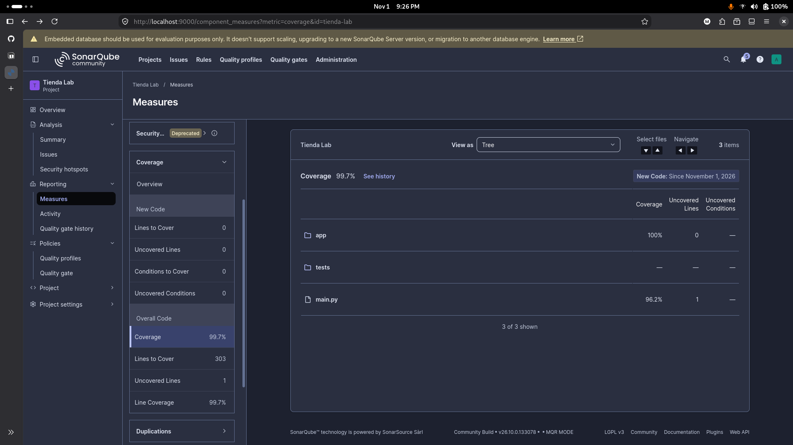
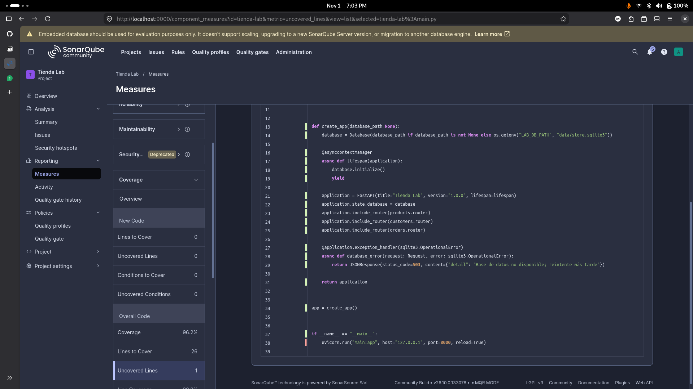
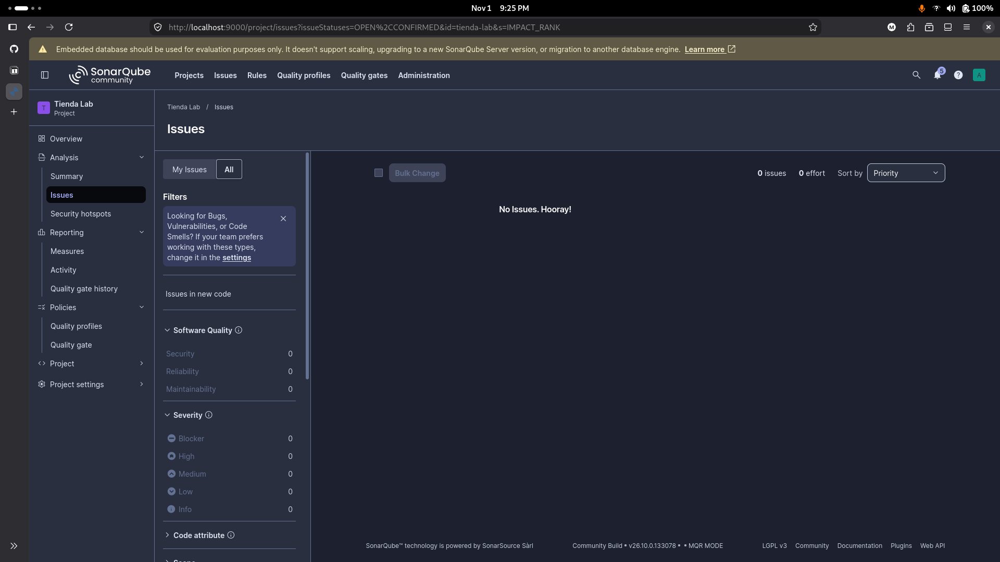
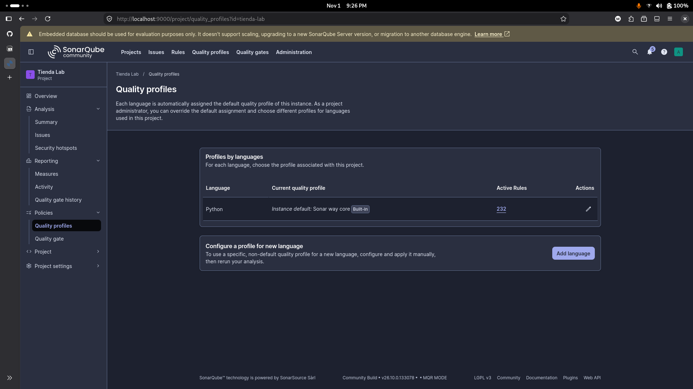

**Hallazgos y limitaciones:**

- **Sonar no reporta ningún issue**, pero el código sí tiene problemas de diseño (sección 4). El perfil `Sonar way core` no detecta duplicación entre métodos, métodos largos por responsabilidades ni números mágicos de negocio.
- **Cobertura inicial subestimada (92 %).** El primer análisis mostró 92 % porque `coverage.xml` declaraba `source = ["app", "main"]` y escribía las rutas sin carpeta (`customers.py` en vez de `app/customers.py`), y Sonar no emparejó `main.py`. Se corrigió en `pyproject.toml` (`source = ["."]`, `omit = [".venv/*", "tests/*"]`) sin excluir código de la aplicación. 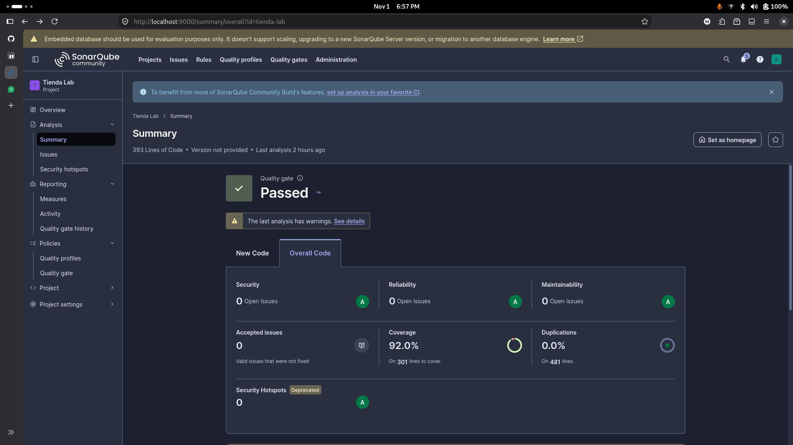
- **Advertencia "Missing blame information for 3 files"**: los tres archivos de prueba nuevos no estaban commiteados cuando se analizó. No afecta a las métricas. 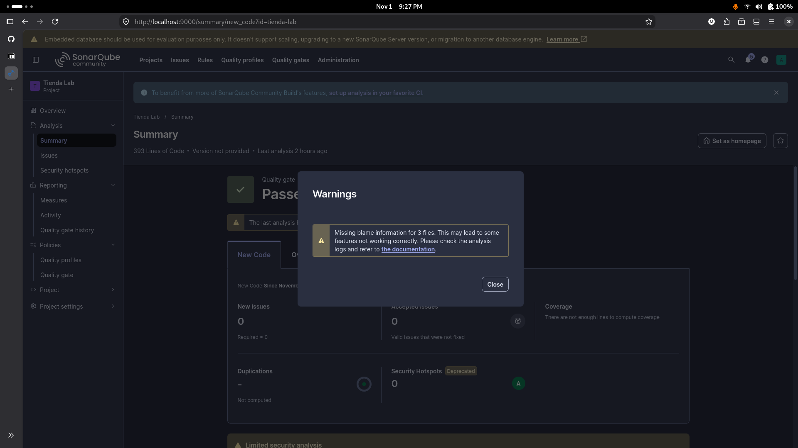

### 3.3 Ejecución de la API

Recorrido inicial del README en Swagger, sobre una base vacía. Todos los resultados coinciden con lo esperado.

| Paso | Resultado | Captura |
| --- | --- | --- |
| Servidor iniciado con `uv run main.py` | Uvicorn en `127.0.0.1:8000`, `/docs` y `/openapi.json` responden 200 | 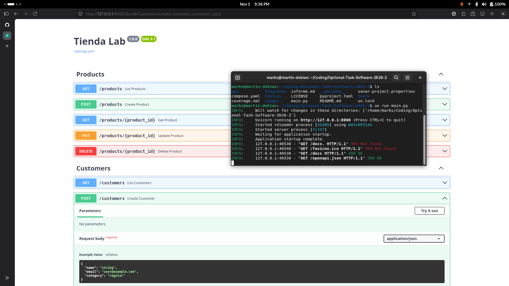 |
| `POST /customers` (Ana Torres, premium) | 201, `id: 1` | 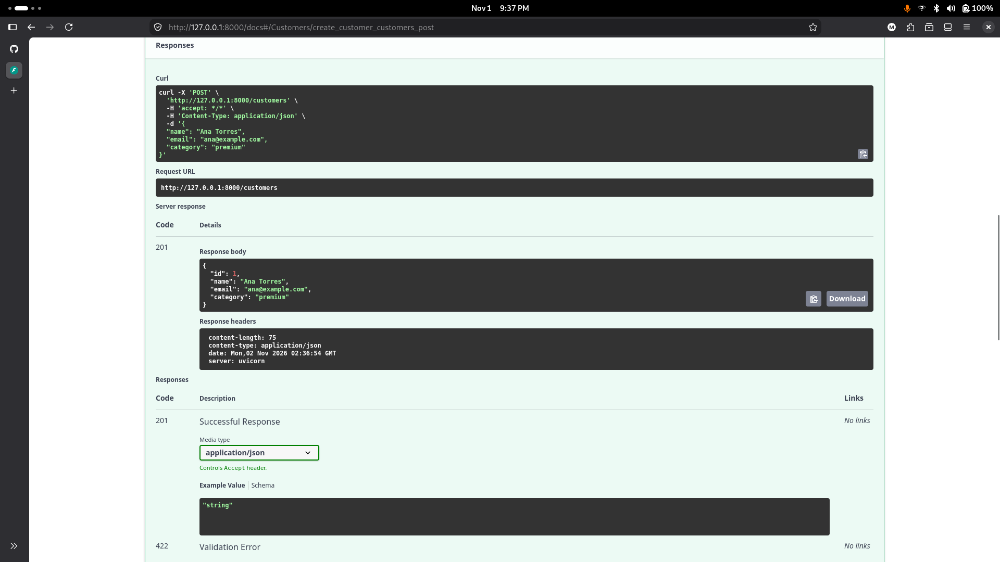 |
| `POST /products` (Libro de algoritmos, 2500, stock 5) | 201, `id: 1` | 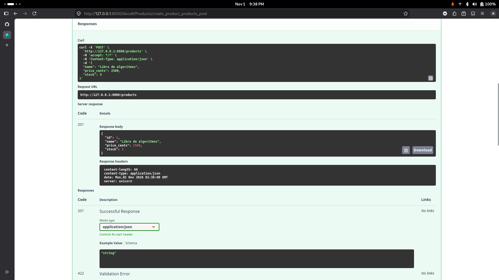 |
| `POST /orders/quote` | 200: subtotal 5000, descuento 500, envío 1000, total 5500 | 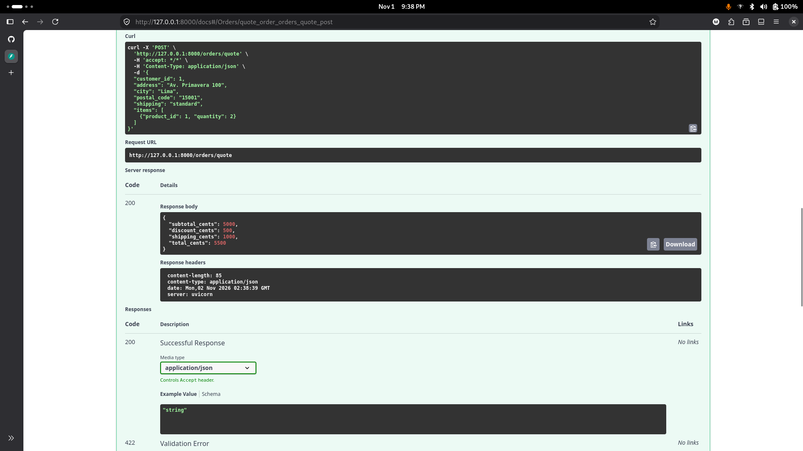 |
| `POST /orders` | 201, estado `pending`, mismos importes | 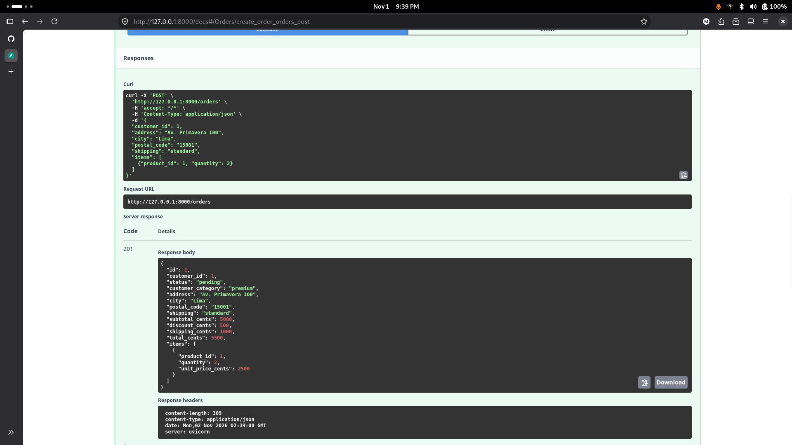 |
| `POST /orders/1/confirm` | 200, estado `confirmed` | 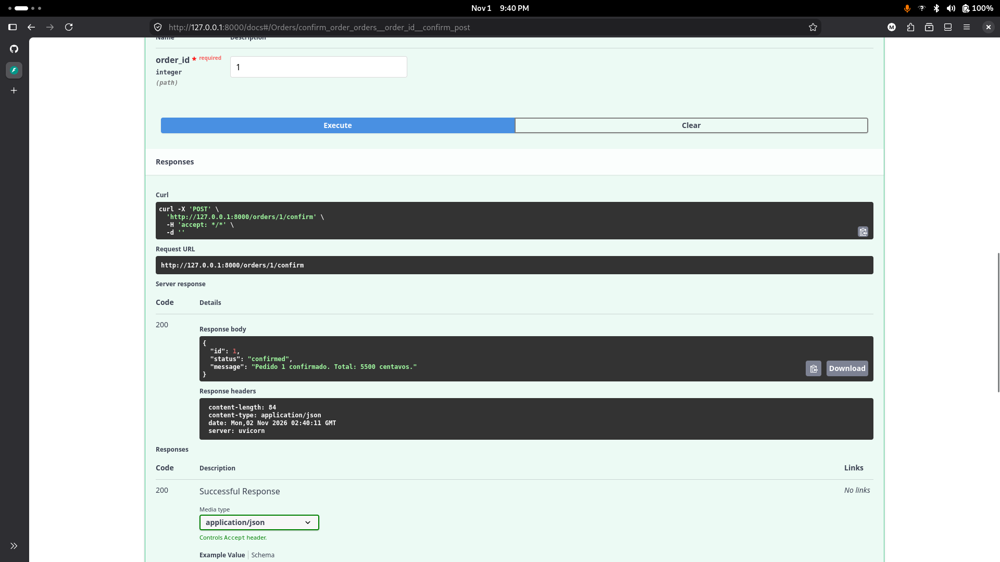 |
| `GET /products/1` | stock 3 | 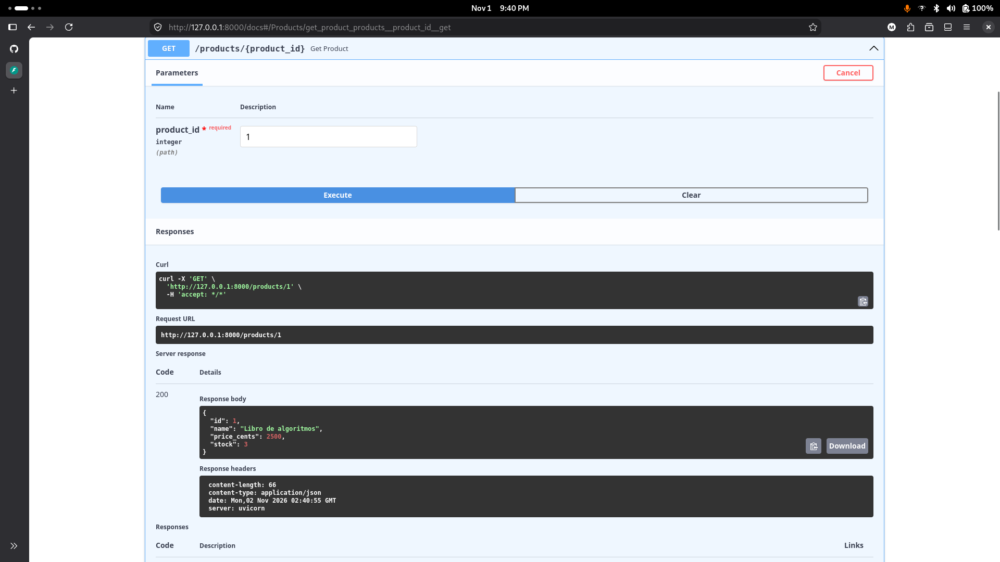 |
| `GET /orders/1/notifications` | 1 notificación para `ana@example.com` | 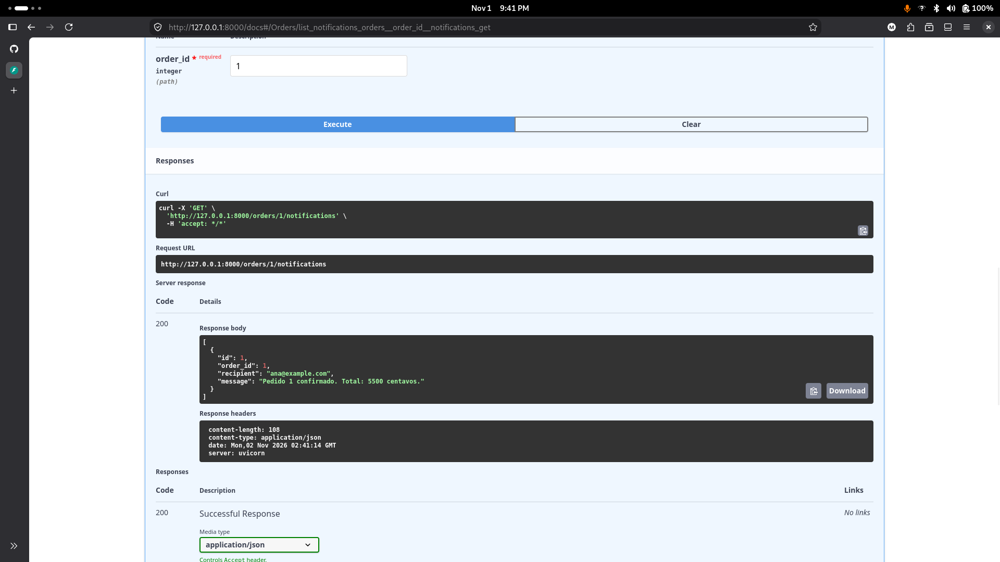 |
| `POST /orders/1/confirm` (repetido) | 409 "El pedido ya no está pendiente", sin otro descuento de stock | 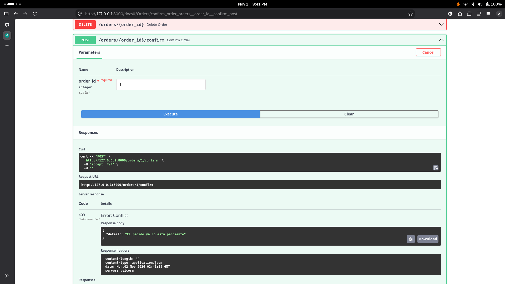 |

Versiones: 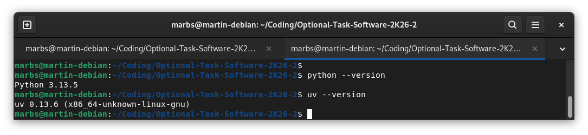

Pruebas y cobertura antes de refactorizar (76 pruebas, 99,67 %): 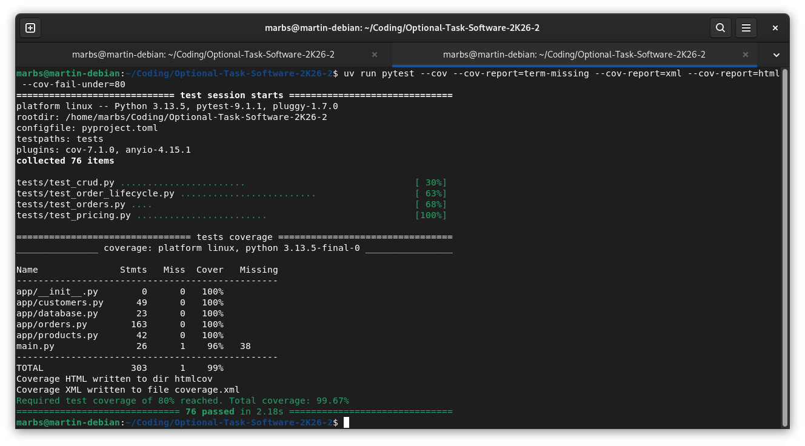

## 4. Code smells (código inicial)

Todas las líneas corresponden a `app/orders.py` en el tag `pre-refactor`.

### Smell 1 — Código duplicado (Dispensables)

- **Dónde:** `OrderService.save` (líneas 52-64) y `OrderService.quote` (líneas 103-114).
- **Fragmento:**
  ```python
  if customer["category"] == "premium":
      discount = subtotal * 10 // 100
  elif customer["category"] == "business":
      discount = subtotal * 15 // 100
  ...
  if shipping == "pickup": delivery = 0
  elif shipping == "standard": delivery = 0 if subtotal >= 10_000 else 1_000
  ```
- **Problema:** el cálculo de descuento y envío está escrito dos veces. Si cambia una tarifa y se edita solo una copia, `POST /orders/quote` y `POST /orders` devuelven totales distintos para el mismo pedido.
- **Cambio que lo haría evidente:** subir el envío express de 2500 a 3000.

### Smell 2 — Método largo (Bloaters)

- **Dónde:** `OrderService.save`, líneas 33-90 (58 líneas).
- **Fragmento:** el mismo método valida el pedido (líneas 35-43), consulta productos (46-51), calcula precios (52-64), inserta o actualiza según `order_id` (67-80) y arma la respuesta (85-89).
- **Problema:** crear y editar comparten un método con una bandera (`order_id=None`) y 7 parámetros. No se puede probar el cálculo de precios sin una base de datos.
- **Cambio que lo haría evidente:** agregar un campo al pedido obliga a tocar el `INSERT`, el `UPDATE` y los parámetros a la vez.

### Smell 3 — Números y cadenas mágicas (Dispensables)

- **Dónde:** `save` y `quote`, líneas 52-63 y 103-114.
- **Fragmento:** `subtotal * 10 // 100`, `subtotal * 15 // 100`, `>= 10_000`, `1_000`, `2_500`, y las cadenas `"premium"`, `"business"`, `"pickup"`, `"standard"`.
- **Problema:** las reglas de negocio de la tabla del README están sueltas dentro del código, sin nombre. Cambiar una tarifa exige buscar el número en varios sitios.
- **Cambio que lo haría evidente:** cambiar el umbral de envío gratis de 10 000 a 15 000.

### Smell 4 — Condicionales por tipo (Change Preventers)

- **Dónde:** `save` y `quote`, cadenas `if/elif/else` de categoría de cliente y tipo de envío.
- **Problema:** añadir una categoría de cliente (por ejemplo `vip`) o un envío (`same_day`) obliga a modificar los condicionales en cada copia. Un tipo nuevo cae silenciosamente en la rama `else`: un envío desconocido cobra como express.
- **Cambio que lo haría evidente:** agregar la categoría `vip` con 20 % de descuento.

### Smell 5 — Mezcla de responsabilidades (Couplers)

- **Dónde:** `OrderService`, líneas 38, 40, 43, 49, 96, 101, 122, 138, 140, 148, 162, 164, 172, 174.
- **Fragmento:** `raise HTTPException(404, "Pedido no encontrado")` dentro de la clase de servicio, junto con SQL escrito a mano en cada método.
- **Problema:** la lógica de negocio depende de FastAPI y de SQLite a la vez. No puede reutilizarse desde otro adaptador (un worker, un script) sin arrastrar HTTP. La consulta "buscar pedido o 404" se repite en cinco métodos (líneas 120-122, 136-138, 160-162, 170-172, y en `save`).
- **Cambio que lo haría evidente:** cambiar el texto o el código de "pedido no encontrado".

## 5. Diagrama de clases inicial

Fuente editable: `diagramas/inicial.mmd`. Solo se dibujan clases reales; las rutas y `create_app` son funciones.

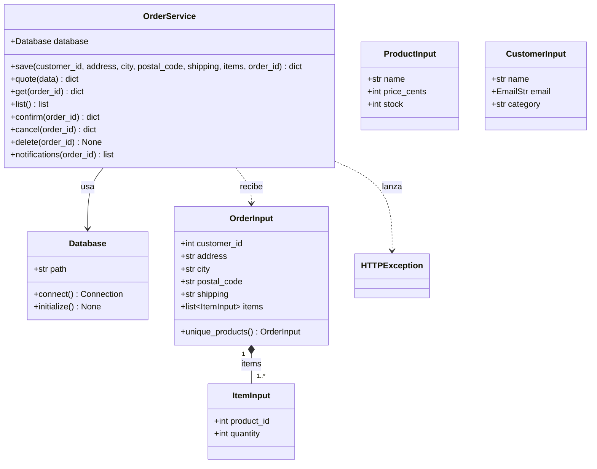

## 6. Técnicas de refactorización

Se mantienen rutas, contratos HTTP, reglas de negocio y transacciones. Las 76 pruebas pasan sin cambiar ninguna expectativa; solo se adaptó la llamada `save(...)` a `create(...)` en `tests/test_pricing.py`.

### Técnica 1 — Extract Function (a módulo `app/pricing.py`)

- **Problema:** smells 1 y 2. El cálculo de descuento y envío estaba duplicado en `save` y `quote`.
- **Antes:**
  ```python
  # save() y quote(), copiado dos veces
  if customer["category"] == "premium":
      discount = subtotal * 10 // 100
  elif ...
  total = subtotal - discount + delivery
  ```
- **Después:**
  ```python
  # orders.py
  return customer["category"], lines, price_order(customer["category"], data.shipping, subtotal)
  ```
- **Mejora:** hay una sola implementación de la regla. Se prueba sin base de datos y `quote` y `create` no pueden divergir.

### Técnica 2 — Replace Magic Number with Symbolic Constant

- **Problema:** smell 3. Tarifas y porcentajes sin nombre.
- **Antes:** `subtotal * 15 // 100`, `>= 10_000`, `1_000`, `2_500`.
- **Después:**
  ```python
  FREE_SHIPPING_THRESHOLD_CENTS = 10_000
  STANDARD_SHIPPING_CENTS = 1_000
  EXPRESS_SHIPPING_CENTS = 2_500
  ```
- **Mejora:** cambiar una tarifa es editar una línea y el nombre documenta la regla.

### Técnica 3 — Replace Conditional with Lookup Table

- **Problema:** smell 4. Cadenas `if/elif` por categoría de cliente y tipo de envío.
- **Antes:** `if shipping == "pickup": ... elif shipping == "standard": ... else: ...`
- **Después:**
  ```python
  DISCOUNT_PERCENT = {"regular": 0, "premium": 10, "business": 15}
  SHIPPING_COST = {"pickup": ..., "standard": ..., "express": ...}
  delivery = SHIPPING_COST[shipping](subtotal)
  ```
- **Mejora:** añadir una categoría o un envío es añadir una entrada. Un tipo desconocido ya no cae en silencio en la rama `else` (express): provoca un `KeyError` visible.

### Técnica 4 — Remove Flag Argument (con Extract Method)

- **Problema:** smell 2. `save(..., order_id=None)` hacía dos cosas según una bandera, con 7 parámetros.
- **Antes:** `save(customer_id, address, city, postal_code, shipping, items, order_id=None)`
- **Después:** `create(data)` y `update(order_id, data)`, con helpers privados `_price`, `_values`, `_save_lines`, `_find` y `_pending`.
- **Mejora:** cada método hace una cosa. La consulta "buscar pedido o 404" y la de "debe estar pendiente", antes repetidas en cinco métodos, viven en `_find` y `_pending`.

### Técnica 5 — Introduce domain exceptions (desacoplar de HTTP)

- **Problema:** smell 5. `OrderService` lanzaba `HTTPException` de FastAPI.
- **Antes:** `raise HTTPException(404, "Pedido no encontrado")`
- **Después:** `raise NotFound("Pedido no encontrado")`, con `NotFound` y `Conflict` en `app/errors.py` y un único manejador en `main.py` que responde `{"detail": ...}` con el mismo código.
- **Mejora:** el servicio ya no depende de FastAPI. El contrato HTTP (código y mensaje) no cambia.

## 7. Estado final

### 7.1 Diagrama de clases final

Fuente editable: `diagramas/final.mmd`. `app/pricing.py` contiene solo funciones y constantes, por eso no aparece como clase.

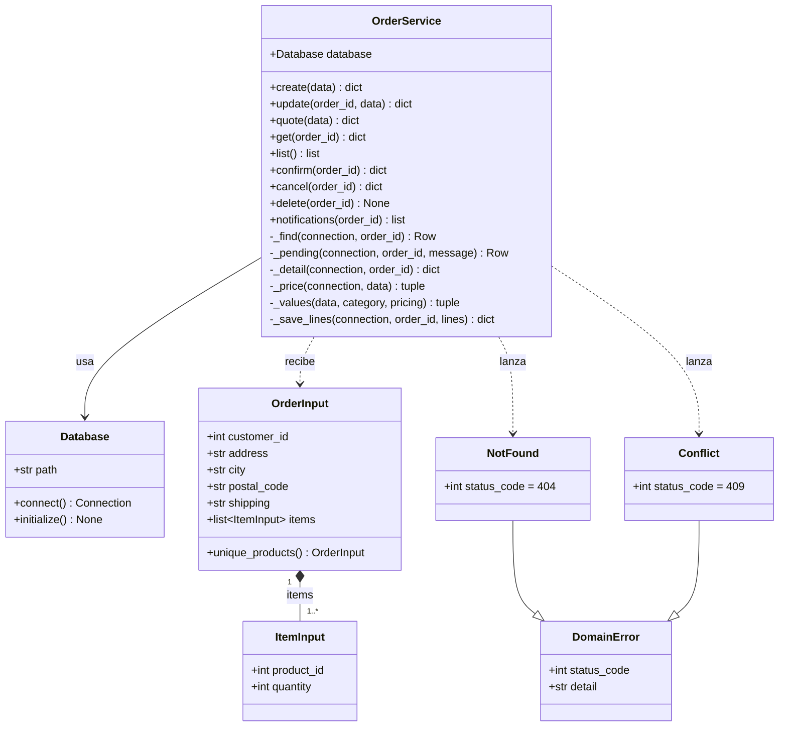

### 7.2 Resultados

| Métrica | Antes (`baseline-tests`) | Después |
| --- | --- | --- |
| Pruebas | 76 pasan | 76 pasan |
| Cobertura (pytest) | 99,67 % | 99,66 % |
| Cobertura (SonarQube) | 99,7 % | 99,7 % |
| Líneas de código (`ncloc`) | 393 | 381 |
| `app/orders.py` | 235 líneas | 204 líneas |
| Issues / bugs / vulnerabilidades | 0 / 0 / 0 | 0 / 0 / 0 |
| Duplicación | 0,0 % | 0,0 % |

Capturas "después": _pendiente de añadir en `images/despues-*.png`_.

La única línea sin cubrir sigue siendo `uvicorn.run` (ahora `main.py:43`). El porcentaje baja una centésima solo porque el código tiene menos líneas (297 en vez de 303) y esa línea pesa más. El manejador nuevo está cubierto por las pruebas de 404 y 409.

## 8. Limitaciones

- La línea `main.py:38` queda sin cubrir por ser el arranque del servidor.
- Sonar no detecta los smells de diseño; se documentan manualmente.
- Las pruebas de `test_pricing.py` llaman directamente a `OrderService.quote` y `.save`; si cambian sus firmas al refactorizar se adapta la llamada, no las expectativas.
